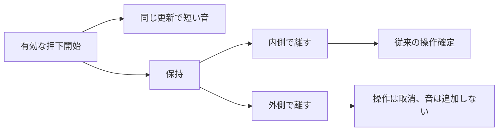

# ボタン押下開始の音の確認

## 変更

基準は9b15da5で、発音タイミングだけを変更した。\
BaseButtonの音をpressedからbutton_downへ移し、GUIの押し始めを同じ更新で一度だけ消費する。\
操作のpressedとaction_modeは変更せず、押して外へ離した場合は音だけが残り操作は成立しない。

通常ボタン、動的候補、トグル、盤面のメニューボタンとプルダウン本体は共通の接続を使う。\
離し、キーリピート、内部の信号再送と値変更、ホバーとフォーカス、盤面予測では新しい音を出さない。

Godot標準のPopupMenuは、確定とwindow_inputの順序が前後しても同じ更新で照合し、発音の遅延呼出しを外した。\
項目側で新しく押し始めた入力を区別し、メニューを開いた押下の離しだけで重複再生しない。\
有効な項目を確実に判定できる公開の位置取得APIはないため、フォーカスだけを使って押下対象を推測しない。\
項目のマウス操作は標準の有効確定通知が最速の根拠であり、項目自体の確定を押下開始へ変更していない。

## 通常Godotの比較

macOS、Apple M4、Godot 4.7.2、Compatibility、1920x1080、上限60fps、CoreAudioで実行した。\
通常のmain.tscnと隔離した全解放データを使い、約200ms保持してから離すGUIイベントを送った。\
マウスの実座標もGodotのカーソルで合わせ、押下、再生要求、操作とMaster信号を記録した。\
人の物理キー入力と耳での聴感とは区別する。

| 条件 | 旧版の要求時刻 | 新版の要求時刻 | 新版の保持中 | 新版の離した後の操作 |
| --- | --- | --- | --- | --- |
| 静的ボタン、マウス | 約236.49ms | 約0.10ms | 音1回、操作0回 | 操作1回、追加音なし |
| 静的ボタン、Enter | 約250.35ms | 約0.04ms | 音1回、操作0回 | 操作1回、追加音なし |
| 動的CLASS候補 | 約224.23ms | 約0.09ms | 音1回、操作0回 | 候補変更1回、追加音なし |
| 外へ離して取消 | 音なし | 約0.08ms | 音1回、操作0回 | 操作0回、追加音なし |
| ENEMY CPUトグル | 約225.80ms | 約0.10ms | 音1回、操作0回 | 変更1回、追加音なし |

時刻はGodotへ押下を渡す直前からの差であり、旧版の値には意図的な保持時間が含まれる。\
新版はすべて同じ入力処理中に要求し、保持を終える前に音が出た。\
音が必要な5条件のMaster信号は押下から推定約1.56ms後に立ち上がり、音の区間は約31.38ms、最大振幅は約0.03162だった。\
ミックスのブロック境界を含む推定で、物理出力の時刻ではない。

プルダウン本体をマウスで押して保持した場合も音1回で、離しても計1回のままだった。\
実描画でEnglish行の位置を確認して押し、標準項目の保持中は確定も音もなく、離すと確定1回と音1回になった。\
音の要求は項目確定の通知から約0.48ms後で、追加の遅延呼出しはなかった。\
この項目のマウス操作は押下開始の音ではなく、標準の確定時点が限界である。

プルダウンのキー確定は旧版では入力処理を返した後に鳴り、新版では返す前に鳴った。\
保持中に音1回、離した後も計1回であり、候補の選択結果は維持した。\
実際の検証対象はGodotの埋め込みPopupMenuであり、OS固有のメニューバーではない。

CPUの1手も隔離した通常Godotで完了まで再生し、2マスの交互4音と攻撃音だけでボタン音は0回だった。\
主検証は全解放を終了して通常BUILDへ戻し、CPU検証もBUILDへ戻して各プロセスを終了した。

## 自動検査と不変条件

既存の入力検査を保持と取消へ先に変更し、旧実装で55検査中6失敗を確認した。\
新実装はSFX55検査0失敗、SIDE INFORMATION91検査0失敗となった。\
既存メニューの接続検査は、操作のpressedと音のbutton_downがそれぞれ正しい所有者と対象へ一度だけ接続することを厳密に確認する。

離したときだけ鳴らす誤実装は5失敗、離しでも二重に鳴らす誤実装は6失敗となった。\
押下と離しの最終音数だけでなく、保持中の音と操作も照合するため、早まっていない実装を見逃さない。\
取消の境界だけを1件追加し、バランス依存の期待値を増やしていない。

生成PCM、約32msと880Hz、立ち上がり3ms、減衰12ms、-30dBは変更していない。\
game/tuning.gdとui/main.gd、音生成と既存の戦闘音の各処理は基準とバイト一致する。\
原音、インポート設定、NOTICEと.DS_Store、通常保存と設定の19件は、存在とSHA256、更新時刻が作業前と一致した。\
追加の音源、UI、音量設定と保存形式はない。

## 残る確認

耳での好みと音量、物理機器の追加遅延、物理キーとゲームパッドは未確認である。\
実機確認REQ-057-S02は未確認を維持し、信号確認で成功へ変えない。\
標準項目のマウス確定を押下開始へ変えるには項目の判定か操作の再設計が必要になるため、今回は行わない。

記録はartifacts/runtime/button-down/のbefore.json、after.json、popup-mouse.json、cpu-runtime.jsonと各スクリプト、ログにある。\
既存の成果物は上書きせず、新しい検証用の記録だけを保存した。\
push、公開、音源のアップロードは行っていない。

## 仕様の照合と全体検証

- 完全性: 4タスク完了、変更要件1件とシナリオ2件を照合した。
- 正確性: 押下音と操作の時期、保持、取消、重複と無音の境界を自動検査と代表の実GUI接続へ対応付けた。
- 一貫性: D-01のbutton_downとD-02の同じ更新の標準項目確定に従い、波形と操作側の時期を維持した。
- npm run check: 成功。SFX55検査、SIDE INFORMATION91検査、正式仕様9件とトレースも成功した。
- git diff --check、公開関数コメント検査、変更仕様とトレースのstrict検証: 成功。
- CRITICAL、WARNING、SUGGESTION: なし。

変更部分の自動検査と仕様の照合に省略はない。\
主観の聴感など既存の未確認30件は成功へ変更していない。\
本人の.DS_Storeは未追跡のまま保持する。
