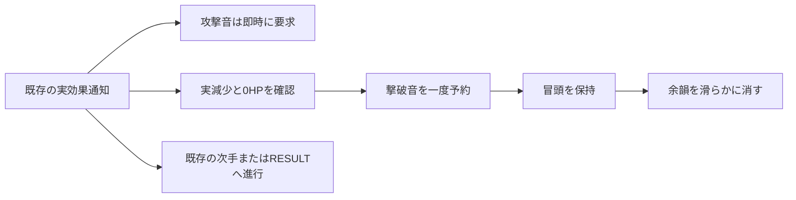

# 撃破音と余韻の確認

## 変更

基準は10ff386で、本人提供のassets/sfx/defeated.oggを原本のまま追加した。\
既存の移動用2音、攻撃と回復の原音、ゲインと発音条件は維持する。\
実HP減少が正の攻撃で0HPになった結果だけに、戦闘と履歴番号で一度だけ予約する。

原音は1.980秒で、振幅0.001以上への立ち上がりは約0.045msだった。\
既存のattack.oggは同じ基準で約131.54msだった。\
短い固定遅延だけでは撃破音のほうが先に聞こえるため、この差を含めて単一の遅延を選んだ。\
原音の再生位置の補正と別のタイマーは重ねない。

| 設定 | 値 | 理由 |
| --- | --- | --- |
| HP変化からの遅延 | 0.24秒 | 攻撃の立ち上がりから約0.1秒後に続け、既存の赤い収束0.42秒の中で始める |
| 初期ゲイン | -18dB | 冒頭のRMSを既存の攻撃と近い控えめな強さにする |
| 原音の保持 | 0.20秒 | 立ち上がりの成分を変えない |
| フェード | 0.65秒 | 振幅をsmoothstepで0へ滑らかに下げ、長い余韻を短くする |
| 撃破用の独立声数 | 6 | 6体戦で近接した撃破の余韻を上書きしない |

値の定義はgame/tuning.gdだけに置く。\
撃破音自体は約0.85秒、HP変化から名目約1.09秒で完了する。\
更新が遅れた場合も冒頭が途中から弱まらないよう、包絡の保持は実際の再生要求から数える。\
専用プレイヤーの音量だけを変え、Masterと既存の2レーンにはフェードを掛けない。

次手とRESULTへの遷移は余韻を止めず、ゲームの操作と進行を待たせない。\
明示的なBUILD復帰、停止と退出では予約と残響を破棄し、再戦へ持ち越さない。\
音声時計は実時間で進め、CPU早送りで原音を加速しない。

## 実ランタイム

macOS、Apple M4、Godot 4.7.2、Compatibility、1920x1080、上限60fps、CoreAudioで隔離実行した。\
通常のui/main.gdと6体の戦闘を使い、独立した検証用の保存先を指定した。\
非致死と撃破の分岐だけを確定させるため、使い捨ての配置とHPを用意した。\
プレイヤーは合法な1歩と攻撃を確定し、CPU側は通常の判断と段階表示を動かした。\
ダメージの値をバランスの合否条件にはしていない。

| 条件 | 音列 | 撃破要求の遅れ | Masterの攻撃立ち上がり | 撃破専用信号の立ち上がり | 結果 |
| --- | --- | --- | --- | --- | --- |
| 非致死 | 回転1、回転2、攻撃 | なし | 約135.7ms | 信号なし | 対象は生存、次手へ |
| プレイヤー撃破 | 回転1、回転2、攻撃、撃破 | 約237.5ms | 約135.7ms | 約233.9ms | 対象は盤面から除外、次手へ |
| CPU撃破 | 回転1、回転2、攻撃、撃破 | 約237.3ms | 約135.7ms | 約233.9ms | 対象は盤面から除外、次手へ |
| 最後の敵を撃破 | 回転1、回転2、攻撃、撃破 | 約236.2ms | 約135.7ms | 約233.9ms | VICTORYのRESULTへ |

立ち上がりは攻撃の要求時にバッファを区切り、振幅0.001へ達した時刻を測った。\
信号はミックスのブロック境界と時計差を含む推定であり、物理的な出力機器の時刻ではない。\
耳での聴感と遅延ゼロを保証するものではない。

プレイヤー撃破ではHP変化後約0.28秒と0.45秒で-18dBを保持し、約0.58秒で-19.0dB、0.85秒で-27.5dB、0.98秒で-39.0dBとなった。\
約1.11秒には専用プレイヤーの再生が終了していた。\
撃破専用の50ms窓RMSは前半約0.05から末尾約0.00005まで低下した。\
CPUとRESULTでも同じ包絡と実信号があり、次手と終局で即断されなかった。\
撃破の繰り返しは各列1回だった。

実描画のplayer-kill.pngを確認し、対象が消え、既存の赤い収束とDEFEATEDが表示される位置を確認した。\
UIと演出は変更していない。\
確認後は通常BUILDへ戻して検証プロセスを終了した。

計測用runtime.gd、runtime.json、波形のsources.json、各ログとPNGはartifacts/runtime/defeated-sfx/へ新規に保存した。\
素材と計測画像のアップロードは行っていない。

## 検証と不変条件

既存のSFX検査へ最小限の撃破と包絡の確認を加えた。\
先に旧実装で34検査中2失敗を確認し、新実装では42検査0失敗となった。\
更新が遅れた場合の冒頭保持も既存の同じ検査を強め、修正前3失敗から修正後0失敗を確認した。\
正確な音列、遅延前の無音、保持後の低下、複数の余韻、再表示の重複、実減少ゼロと非致死、回復、停止と再戦を検査する。\
画面との接続は実撃破の代表例だけを追加し、固定ダメージと勝敗手数の期待値は増やしていない。

原音7個、本人の.DS_Storeと通常セーブ、通常設定2個の計11件は、存在、SHA256と更新時刻が作業前と一致した。\
通常保存、言語と配色の設定を変更していない。\
移動音の開始フレームと音列、HPの計算、攻撃と回復の表示タイミングとゲインは維持する。

## 残る確認

耳による音の好みと音量、物理機器の遅延は未確認であり、REQ-057-S02を未確認へ戻した。\
出典とライセンスを確定できる文書は同梱されておらず、推定や公開はしない。\
負荷や機器による実時間の揺れを含め、最終の聴感は本人の実機で確認する。

## 仕様の照合と全体検証

| 観点 | 結果 |
| --- | --- |
| 完全性 | 5タスク完了、追加と変更の要件2件、シナリオ4件を照合した |
| 正確性 | 自動検証の3シナリオを部品と代表の画面接続へ対応付けた。聴感の1シナリオは台帳で未確認を維持する |
| 一貫性 | D-01とD-02に従い、独立した声と単一遅延、実再生からの保持と滑らかな振幅を使う |

- npm run check: 最終コードで成功。SFX42検査0失敗、正式仕様9件とトレースの検査も成功。
- 変更仕様のstrict検証とstrictトレース: 成功。
- git diff --checkと公開関数コメント検査: 成功。
- 遅延を省く、フェードを省く、重複防止を省く3つの誤実装で、それぞれ4件、1件、1件の失敗を確認した。
- CRITICAL、WARNING、SUGGESTION: なし。

実装と自動検査の照合は完了した。\
REQ-057-S02の物理出力と主観的な聴感は未検証である。\
既存の実機未確認30件を成功へ変更していない。\
実装の依存として新しい原音とGodotのインポート設定を管理し、本人の.DS_Storeは未追跡のまま保持する。
