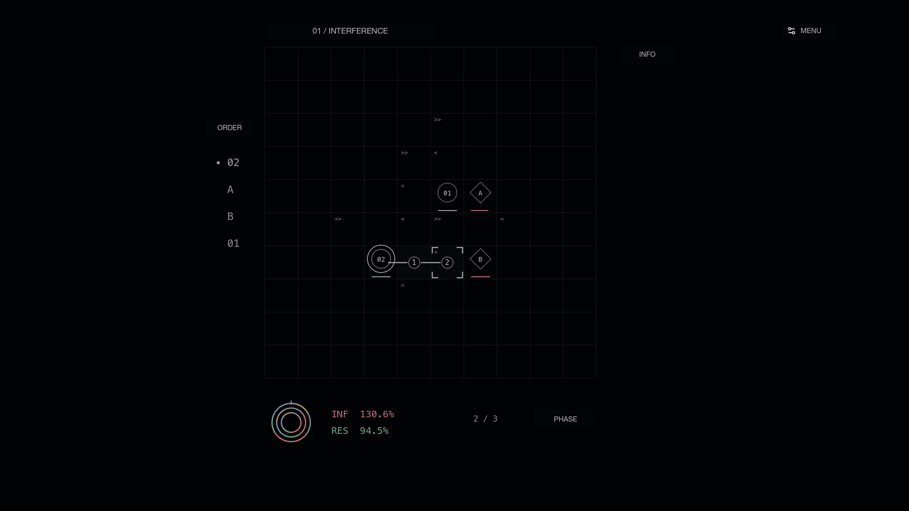

# 最小表示への再設計と検証

この変更は利用者の依頼により取り消した。
以下は52a5dc5時点の履歴であり、現行UIの説明ではない。
復元範囲と現在の検証はartifacts/restored-interface-verification.mdに記録する。

## 結果

前回の戦闘画像を基準に、構成、情報の常時表示、文言、色面、線幅を変更した。
戦闘式、ステージ条件、収集規則、保存形式、両陣営の手動操作は変更していない。
Godot 4.7.2、Compatibility、Apple M4、macOSのRetina環境を使った。
追加アプリ、公開、pushは行っていない。

## 必須性の判断

| 前回の要素 | 変更 | 判断根拠 |
| --- | --- | --- |
| 大きな左右パネル、標語、反復見出し、座標軸 | 削除 | 手を選ぶための情報を増やさない |
| 盤面と手番と詳細の12組のリング | 予測の1組へ集約 | 盤上は陣営の形、ID、HPで識別できる |
| 6手のリング、同期値、HPの反復 | 4手のID、詳細ORDERへ | 通常は次の順序で足り、集計と正確な時刻は開いて調べられる |
| 装備型番、15能力値、全スキル | INFO/Iへ | 相手の構成は必要だが、毎手の常設は不要である |
| 4波形、正確な角度、終点座標 | PHASE/Pへ | 数値だけで足りない比較を必要時に行える |
| 特異点不成立、NORMALの反復 | 不成立時は省略 | 成立と変異だけを示す |
| 目標と説明 | ステージ名、HELPへ | 説明を読む場面と実行する場面を分ける |
| 中央のACTION | 盤面右へ | 盤面、HP、位相予測を覆わない |
| BUILDの全入力 | CORE/EQUIP/SKILLSへ | 編集目的ごとに必要なものを保つ |
| HELP、SETTINGSの長い1枚 | 目的別ページへ | 必要な説明と設定だけを開く |
| RESULTの型番と全能力値 | 取得品を開いて確認 | 勝敗と何を得たかを最初に伝える |
| 大面積の色見本、太いリング、すべてのボタン枠 | 小見本、細線、選択とフォーカスの枠へ | 色面を減らし、必要な強調に面積を使う |

背景は#010203、面は#030405である。
本文と補助文字、5色は一律に透明化せず、配色部品の4.5:1基準を維持する。
色設定とLucideの同梱、ラベルとライセンスは継続している。
PLAYERは円、ENEMYは菱形、手番は外周と点で示す。
経路番号、終点、ターゲットの正負符号、GOALとLOSSは残す。

## 測定

同じ1920x1080、TURN2、AのHP89、02の経路(4,6)→(5,6)、INF130.6%、RES94.5%で比較した。
前回画像はui-review/essential-before.png、前回の描画文字はessential-baseline.jsonに保存した。
文字数は描画した文字と可視GUIの文字の総数であり、ツールチップと閉じた内容を含めない。
リング組数は3層を1組として数える。
輝度はGodotがPNGを読み、各ピクセルのsRGBを線形化し、0.2126R+0.7152G+0.0722Bを全面積で平均した。
文字数はtests/frame_audit.gdとtests/essential_flow.gd、輝度はtests/essential_render.gdで再現できる。

| 指標 | 前回 | 新表示 | 削減 |
| --- | --- | --- | --- |
| 常時表示の文字 | 786 | 89 | 88.7% |
| リングの組数 | 12 | 1 | 91.7% |
| 平均相対輝度 | 0.0204844025 | 0.0015413117 | 92.5% |

削減目標の前回比50%以下を満たした。
これは同一場面の指標であり、すべての取得品や状態の文字数を保証するものではない。

## 実レンダー

GodotのGPU実行で全画面を描き、ウィンドウのビューポートからPNGを保存して目視確認した。
画像の加工やデスクトップの切り抜きは行っていない。
個人情報とデスクトップを含まない。
既定色とAMBERで、BUILDの3ページ、BATTLE、詳細、ACTION、攻撃対象、HELPの3ページ、SETTINGSの2ページ、RESULTの0件/2件と取得品詳細を確認した。
RESULTの0件/2件は表示fixtureであり、実ステージの短期攻略を示さない。

| 表示 | 証拠 |
| --- | --- |
| 通常戦闘 | ui-review/essential-battle.png |
| 任意の詳細と4波形 | ui-review/essential-battle-details.png |
| BUILD | ui-review/essential-build-core.png、essential-build-equip.png |
| ACTIONと攻撃対象 | ui-review/essential-action.png、essential-target-attack.png |
| 行動中と対象選択中の詳細 | ui-review/essential-action-info.png、essential-target-info.png |
| 変更した配色 | ui-review/essential-amber-battle.png、essential-amber-build-core.png |
| HELP、色設定 | ui-review/essential-help-phase.png、essential-settings-color.png |
| RESULT | ui-review/essential-result.png |

独立実行では全画面、1440x810への復帰、1200x1600の縦長、AMBERの描画を検査した。
ビューポートPNGはゲーム領域を保存するため、OSウィンドウの余白を含まない場合がある。
余白は最終変換のオフセットで検査し、クリックは8寸法の表示入力テストで確かめた。
埋め込み実行のFULLSCREENはGodotの外側のゲームビューに管理されるため、独立実行と区別した。

## 実操作

共有Godotの埋め込み1438x809画面で、BUILDの3ページと01/02切替、HELP、設定、最小戦闘表示を実際に操作した。
経路2歩、Esc取消、再入力、確定、攻撃選択、EscのBACK、再選択、対象クリックを通した。
Aの詳細を開いても01の予測を維持し、Pで4波形を開閉した。
選択枠とTab/Shift+Tabの枠を確認した。

今回の6手は次の操作である。
座標はゲーム内セルであり、すべてクリックで移動を確定した。

| 手 | ユニット | 経路 | 行動 |
| --- | --- | --- | --- |
| 1 | 01 | (4,4)→(5,4) | Aへ攻撃、-11 |
| 2 | 02 | (4,6)→(5,6) | Bへ攻撃、BのHP71 |
| 3 | A | (6,5)→(5,5) | 01へ攻撃、-17 |
| 4 | B | (6,5) | Aを回復、+11 |
| 5 | 01 | (4,4)→(4,5) | Aへ攻撃 |
| 6 | 02 | (5,7)→(4,7)→(4,6) | 01を回復、+17 |

双方で攻撃と回復を選択でき、戦術情報を開くために手番や経路を失わなかった。
MENUのRESTARTでBUILDへ戻し、共有画面の操作を終了した。
既存のビルド保存と通常の配色設定は実操作で保存していない。

## 自動検査と検出力

- npm run check: モデル536、UI接続12、レビュー52、拡縮入力61、配色とフォーカス135、最小表示35の全831チェックとプレイ再生が成功した。
- GPU検査: 14チェック、0失敗。
- 前回の28手再生: PLAYER攻撃9/回復7、ENEMY攻撃10/回復2で勝利した。
- 対抗目標と20手/36手の両陣営再生も成功した。
- 回復優先の160コマンドで未終了となる既知の性質は残る。

初期UIに対して表示削減、開示、ページ分割の7件の失敗を記録してから実装した。
COREの入力が最小幅によって隣接の矢印を覆う問題は、実寸法の4件の失敗から修正した。
GPU検査の最初の3件は既存の描画経路で最初から成功したため、失敗したテストとは扱わない。
既存の表示テストは固定のSTART座標から実ボタンの矩形中心へ変更し、物理座標入力、余白無反応、フォーカス復帰の判断は維持した。
配色テストは新しい背景のコントラスト境界とCOLORページ、HELPのPHASEページへ合わせた。
ゲーム式の期待値は変更していない。
新規検査をscripts/check.shのプロダクト検査へ追加した。

削減のテストは元UIで失敗すること、COREの重なりは見た目の寸法を使って失敗することを確認した。
開示のテストは経路だけでなくユニット全体、操作対象、対象スキルを比較するため、表示を開く際のモデル更新を検出できる。
既存のフォーカス検査は単にフォーカスの有無でなく、最前面の有効部品への所属を確かめる。

## 評価と残課題

既定画面の視線は盤面、手番、予測に集中するようになった。
詳細を開くと全4ユニットの選択部品が現れ、ACTIONと対象選択中も相手の正確なHPと構成を調べられる。
この到達と予測維持は2件の失敗から修正した。
装備の15値や4波形が必要なときだけ増えるため、最小表示の状態で経路を比較しやすい。
一方、I/Pと目標ボタンを一度覚える必要があり、初見の発見性は利用者に最終確認してほしい。

取得時に共通要素が欠けるように見えた例は、保存PNGを直接検査した。
ACTIONと対象選択の詳細領域は各6323画素、AMBERの共通見出しは808画素あり、実画像の情報は保たれていた。
製品の描画欠けとは扱わず、追加した再描画処理は除いた。
退役した面を即時にツリーから外して入力先を一意にする変更は、2件の失敗から成功まで検査した。

今回の人のプレイは6手であり、新UIで自然な勝敗まで通す一戦と、撃破/回復トーストの上昇の通し確認は未確認である。
品位、暗さの好み、長時間の可読性、他ディスプレイと他OSは未検証である。
既知の回復による停滞を今回のUI変更で解消したとは扱わない。
OpenSpecの実機確認表にもこの境界を記録した。
