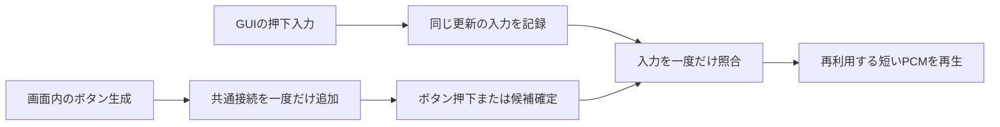

# ボタンの生成音の確認

## 変更

基準はe8d32a0である。\
ボタンの実GUI入力と押下、プルダウンの確定だけに、短い合成音を1操作1回接続した。\
ボタン生成の各所へ音を追加せず、ui/sfx.gdが画面配下の部品と後から追加する候補を共通に監視する。\
同じ更新の入力を一度だけ消費し、内部の押下信号の再送と状態更新は無音にする。

BaseButtonではgui_inputとpressedを照合する。\
PopupMenuでは確定信号の後にもwindow_inputが届くため、同じ更新の遅延呼出しで照合する。\
プルダウンを開く押下と候補の確定は別の操作として各1音、矢印キーによるフォーカス移動は無音である。

| 生成音の設定 | 値 |
| --- | --- |
| 長さ | 0.032秒 |
| 周波数 | 880Hzのサイン波 |
| 立ち上がり | 0.003秒の滑らかな包絡 |
| 減衰 | 末尾0.012秒の滑らかな包絡 |
| PCM | 44100Hz、モノラル16bit、1411標本、2822バイト |
| ゲイン | -30dB |

値はgame/tuning.gdで定義する。\
AudioStreamWAVを準備時に一度だけ生成し、ファイルへ書かず、同じPCMを使い回す。\
両端は0で、専用の単声レーンをMasterへ接続する。\
SFX有効フラグを尊重し、既存のMasterの音量とミュートを迂回しない。\
ゲーム内の音量設定UIとグローバルな音量変更は追加しない。

元のボタンの動作、位置、外観とゲームルールは変更しない。\
select.oggと旧ring_rotate.oggは未使用のまま保持し、外部素材は追加しない。\
戦闘状態のリセットは短いボタン音を止めず、画面を作り直すボタンでも欠けないようにした。

## 実ランタイム

macOS、Apple M4、Godot 4.7.2、Compatibility、1920x1080、上限60fps、CoreAudioで確認した。\
通常のmain.tscnを使い、独立した保存先と使い捨てのデータで実行した。\
GodotのGUI入力経路へマウスとキーのイベントを送り、操作の結果、発音要求とMasterの実信号を照合した。\
手で物理キーを押す確認と耳の聴感とは区別する。

| 操作 | 生成音の要求 |
| --- | --- |
| BUILDのSLOT変更と画面再生成 | 1回 |
| CLASSを開くボタン | 1回 |
| 動的なCLASS候補の押下 | 1回 |
| CANCELのキー確定と画面を閉じる処理 | 1回 |
| UNLOCK ALLトグルと画面再生成 | 1回 |
| プルダウンを開く操作と候補確定 | 各1回 |
| 未解放候補と無効SAVE | 0回 |
| 内部のプレビュー、設定画面表示、選択値変更と信号再送 | 0回 |
| Tabのフォーカス移動と盤面の経路予測 | 0回 |
| SFX無効中の有効ボタン操作 | 0回 |

信号を測った5つの押下で、振幅0.00001以上の区間は約31.38ms、最大振幅は約0.03162だった。\
ゲインに対応する約-30dBFSで揃い、各画面遷移と全解放の切替後も同じPCMの参照を再利用していた。\
実際のプルダウンは埋め込みウィンドウで確定まで操作した。

CPUの自動更新も生成音と切り分け、1手完了までの音列を別の通常Godotで記録した。\
2マスの交互4音と攻撃音が鳴り、TURN 1から2へ進むまでボタン音は0回だった。\
ボタンの音が混入しないことを確認するための検証であり、戦術と勝敗を評価する試合ではない。\
確認後は通常BUILDへ戻し、検証用Godotを終了した。

通常の出力信号を観測したが、機器から聞こえる時刻と好みは測っていない。\
アプリ終了時に32msの出力完了を待つ処理は追加していない。

## 自動検証と検査の見直し

旧実装で43検査中3失敗を確認し、新実装ではSFX54検査0失敗となった。\
生成PCMの長さ、周波数、両端の0と柔らかい立ち上がりと減衰を、設定値から独立に観測する。\
マウスとキー、静的と動的、無効操作、ホバーとフォーカス、内部更新、重複とSFX無効の境界を検査した。\
入力との照合を外した誤実装は6失敗、包絡を外した誤実装は1失敗となり、検査が違いを見逃さないことを確認した。

既存のメニュー検査が接続1個という内部構造を固定しており、音を追加した2接続では失敗した。\
ケースを増やさず、元の操作へのCallableと音へのCallableの厳密な2個の集合へ更新した。\
元の操作の所有者と対象まで照合し、余分な接続を許容する緩和はしていない。\
変更後のメニューを含むSIDE INFORMATIONは91検査0失敗となった。\
この検査は追加音が既に接続された段階で新しい期待値へ更新したため、初回から成功した。\
単独実行で--language enを付け忘れた試行は英語の文言検査9件が失敗したが、規定どおり言語を明示すると成功した。\
製品の言語動作と検査コマンドは変更していない。

既存のmovement_tick、effect、suspend、reset_battle、_playは基準とバイト一致し、既存5音の音源と音量、発音時刻を維持する。\
撃破の更新にはSFX無効時にUI音も停止する処理だけを加え、通常の遅延と保持、フェードは変更しない。\
バランス依存の期待値と検査コマンドは追加していない。

## 残る確認

主観的な音量と好み、物理機器の遅延、物理キーとゲームパッドは未確認である。\
既存の実機確認REQ-057-S02は未確認を維持し、信号確認と同一視しない。\
通常セーブと設定、本人の原音と既存の成果物は変更しない。\
音源ファイルと画像のアップロード、pushと公開は行わない。

記録はartifacts/runtime/button-pip/のruntime.json、cpu-runtime.json、各実行スクリプトとログにある。

## 仕様の照合と全体検証

| 観点 | 結果 |
| --- | --- |
| 完全性 | 4タスク完了、変更要件2件とシナリオ4件を照合した |
| 正確性 | 自動検証の3シナリオは部品と代表接続へ対応付け、聴感の1シナリオは台帳に未確認として残す |
| 一貫性 | D-01の共通入力接続とD-02の生成、再利用、Masterへの出力に従う |

- npm run check: 成功。SFX54検査、SIDE INFORMATION91検査、正式仕様9件とトレースが成功した。
- git diff --check、GDScript公開関数コメント検査: 成功。
- 変更仕様のstrict検証とstrictトレース: 成功。
- CRITICAL、WARNING、SUGGESTION: なし。

strictトレースで昇格先のファイル名がタスクに明記されていない点を検出したため、実施済みのtech.md更新をタスクへ明記して再検証した。\
既存の実機未確認30件を成功へ変更していない。\
原音、インポート設定、NOTICEと.DS_Store、通常データは計19件とも、存在とSHA256、更新時刻が作業前の記録と一致する。\
本人の.DS_Storeは未追跡のまま保持する。
