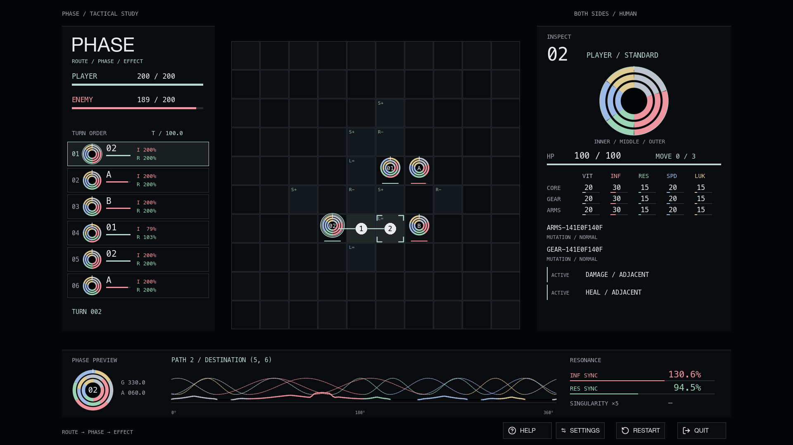

# 中央マップ周辺の指定文字の削除

## 変更

基準はf2c6bbaで、開始時の作業ツリーはクリーンであった。
製品コードの変更はui/main.gdの13行の削除だけである。

- HUD上中央の操作説明を削除した。
- マップのステージ名とゲームモード名を削除した。
- マップ上と左の座標数字と下の勝利条件文を削除した。

盤面の位置とセル、経路、リング、波形、左右パネル、フッター、色、フォント、ゲームルール、保存は変更していない。
中央以外の一時通知も変更していない。
BACKと閉塞時のWAITは同じ位置と処理のままである。
HELPの操作説明とBUILDのステージ選択、目標文は残す。
新しいメニューや説明の移設は行っていない。

## 検査

既存UIで48件中18件が失敗し、指定した描画とラベルを削除した後は48件すべて成功した。
4ステージの移動表示に加え、行動選択、攻撃対象、回復対象、閉塞時、RESULTの背後を独立して検査した。
各fixtureが目的の状態に達したことを確認してから、描画位置と可視HUDラベルを記録した。
文字列だけの検索ではなく、中央マップ周辺の表示領域に文字が残っていないことを確かめる。

BACKは行動選択へ戻して配置を保ち、閉塞時のWAITは手番を進めることをボタンの実コールバックで確認した。
HELPには終点のダブルクリックの説明があり、閉じても未確定経路を保つ。
BUILDでは全4ステージの目標文が残る。

既存のモデル536、UI接続12、レビュー52、表示入力61、配色とフォーカス135、復元12に新規48を加え、全856チェックが成功した。
全プレイ再生とOpenSpecの検査も成功した。
プロダクト検査scripts/check.shに新しい回帰検査を追加した。
既存のテストの期待値や検査は変更していない。

## 実画像と差分

Godot 4.7.2、Compatibility、Apple M4の実ゲームを1920x1080で描画し、ビューポートから未加工のPNGを取得した。
TURN2、手番02、AのHP89、経路(4,6)から(5,6)、INF130.6%、RES94.5%は前回と同じである。
個人情報やデスクトップを含まないことを実画像で確認した。

前回画像restored-battle.pngと比較し、削除対象を囲む5領域内で6162ピクセルが変化した。
それ以外の全ピクセルの差は0であった。
配色、レイアウト、左右パネル、盤面と下部予測を変更していないことを確認した。
比較領域と実画像の取得はtests/map_chrome_capture.gdで再現できる。
Libraryには新しいファイルとして保存し、以前の画像は置き換えていない。

## 確認の境界

表示状態とステージ切替は自動検査、今回の目視は比較用のTURN2である。
全画面と全実操作や新しい一戦を改めて一巡したとは扱わない。
ユーザーが画像を見て次の調整を決める。
既存のセーブと配色設定を変更していない。
pushと公開は行っていない。
