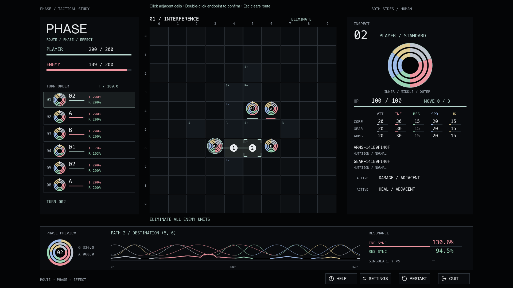

# 変更前のUIへの復元

## 復元範囲

利用者の取消依頼に従い、8d7575dを表示の基準に戻した。
開始時のHEADは52a5dc5で、未コミット変更と後続コミットはなかった。
履歴の書き換え、hard reset、作業ツリー全体の破棄は行っていない。

ui/main.gd、ui/palette.gd、ui/visuals.gdは8d7575dの内容とバイト単位で一致する。
BUILD、BATTLE、ACTION、RESULT、HELP、SETTINGS、配色、ボタン配置、常時の情報パネルと4波形を復元した。
HELPの正しいINF/RES説明と、ACTIONの背後を読める透明な暗幕は8d7575dに含まれており、保持した。
関連する既存UIテストと表示文書も同じ基準へ戻した。
戦闘モデル、式、ステージ、保存形式、Lucide、表示拡縮は変更していない。

52a5dc5の履歴、OpenSpecアーカイブ、画像と検証結果は残した。
最小表示専用の4テストとUIDはartifacts/retired-ui-testsへテキストとして移し、元の内容を保存した。
廃止したREQ-019-S02、NREQ-002-S04、NREQ-002-S05は現行仕様から除き、番号を再利用しない。
復元専用の回帰テストをプロダクト検査へ加えた。

## 検査

復元前の最小表示に対してtests/restored_interface.gdは12件中8件が失敗した。
復元後は12件すべて成功した。
既存のモデル536、UI接続12、レビュー52、拡縮入力61、配色とフォーカス135も成功し、合計808件と全プレイ再生が成功した。
HELPは説明の完全一致、ACTIONは位置、幅、ラベルと暗幕の透明度を確認している。
最小表示専用の検査を廃止したことは、取り消した表示の3シナリオの廃止に対応する。
残る戦闘と保存の期待値は変更していない。

## 実画像

Godot 4.7.2、Compatibility、Apple M4でゲームを新規実行し、実行中のビューポートから1920x1080のPNGを新しい名前で取得した。
画像編集、デスクトップの切り抜き、保存済み画像の流用は行っていない。
個人情報とデスクトップを含まないことを目視確認した。

TURN2、手番02、経路(4,6)から(5,6)、AのHP89、INF130.6%、RES94.5%である。
左右の情報パネル、盤面上のリング、下部の4波形が表示される。
この新規取得画像は、保存していた変更前の画像essential-before.pngとGodot上で全ピクセルが一致した。
再現用の取得処理はtests/restored_capture.gdにあり、既存ファイルを上書きせず毎回新しいPNGを保存する。
Libraryにも新しい画像として保存し、既存画像は変更していない。

共有Godotエディターを再読込し、復元したBUILDを実際に起動して確認した。
操作はBUILDで終了した。

## 保持したデータと確認の境界

既存のビルドセーブ、UI設定、過去の画像、Libraryの既存ファイルを変更していない。
コードと記録の復元は新しいローカルコミットとして記録する。
pushと公開は行わない。

今回の実表示の確認は戦闘画像とBUILDである。
全画面や全操作、自然な勝敗までのプレイを改めて一巡したとは扱わない。
未確認の実機項目はopenspec/manual-checks.mdに明記した。
