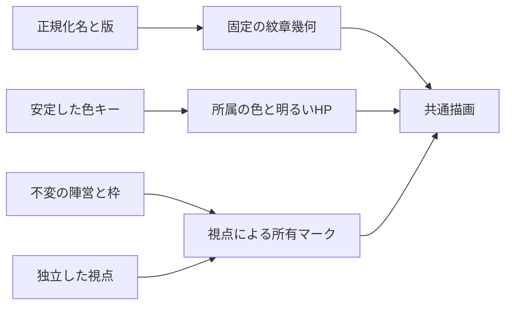

# アセンブリ表示の版1規約

## 目的と識別

名前と安定した色キー、版から、端末と起動をまたいで同じ紋章の幾何を構成する。
紋章と色は表示だけに使い、陣営と枠、対象番号、手番とCPUの識別へ使わない。
同じ名前と色を双方が使っても、衝突回避のために形と色を変更しない。
既存ユニットのdocs/identicon-v1.mdの504形を変更せず、別の規約として扱う。

## 入力と保存

名前はdocs/identicon-v1.mdの固定した空白と制御処理、最大32コードポイントを使う。
大文字小文字とUnicode合成を変えず、空欄はPLAYERでORBIT、ENEMYでVECTORへ解決する。
表示設定は以下の形式であり、versionは紋章方式の版である。

```json
{"name":"ORBIT","color":"PEARL","version":1}
```

nameは正規化した文字列で空文字も許し、colorは後述の安定キー、versionは1である。
未知のキーと版、余分な項目、非文字列と未正規化の名前は拒否する。
通常のゲーム保存は版3でassemblyとして保持し、明示SAVEとLOADだけを使う。\
一時全解放は新規の一時設定を持ち、保存と読込を拒否して通常へ転記しない。
旧保存の移行と自動上書きは行わない。

## ハッシュ

空欄を解決した名前の前に、ASCIIのPHASE/assembly/v1と改行U+000Aを付け、UTF-8でSHA-256を求める。
ユニット用の接頭辞を使わず、名前以外の色と陣営、視点、時刻をハッシュへ含めない。

| 名前 | SHA-256 | family | rotation | cut |
| --- | --- | --- | --- | --- |
| ORBIT | e5cd404250724dca9fc0847869da64577ac945f9765157b038e1e867919af1ac | 1 | 5 | 16 |
| 星環 | 90564b735ee9e54a688ecfaf41bce6569920df2668b96af9533e877de05eeb14 | 0 | 6 | 12 |

バイトを先頭からh0、h1、h2とし、family=h0 mod 4、rotation=h1 mod 8、cut=12+4*(h2 mod 3)とする。

## 幾何

以下の多角形を順序どおりに閉じ、設定色で塗る。
Kはcutであり、原点を紋章の中心、画面の右と下を正とする。

| family | 配置数 | 基本の頂点 |
| --- | --- | --- |
| 0 | 4 | (K,-48)、(34,-48)、(48,-34)、(48,-K)、(34,-K)、(34,-28)、(28,-34)、(K,-34) |
| 1 | 2 | (K,-36)、(44,-36)、(56,0)、(44,36)、(K,36)、(K+10,20)、(32,20)、(40,0)、(32,-20)、(K+10,-20) |
| 2 | 3 | (K,-14)、(42,-24)、(56,-10)、(56,10)、(42,24)、(K,14)、(30,0) |
| 3 | 4 | (K,0)、(34,-20)、(56,0)、(34,20) |

まず配置数の各対(c,s)で、整数の行列R(x,y)=(c*x-s*y,s*x+c*y)を適用する。

| 配置数 | 対(c,s) |
| --- | --- |
| 2 | (1024,0)、(-1024,0) |
| 3 | (1024,0)、(-512,887)、(-512,-887) |
| 4 | (1024,0)、(0,1024)、(-1024,0)、(0,-1024) |

次にrotationで選ぶ以下の対で同じ整数行列を適用する。

| rotation | 対(c,s) |
| --- | --- |
| 0 | (1024,0) |
| 1 | (724,724) |
| 2 | (0,1024) |
| 3 | (-724,724) |
| 4 | (-1024,0) |
| 5 | (-724,-724) |
| 6 | (0,-1024) |
| 7 | (724,-724) |

最後に64*1024*1024で割って単位円内の座標にし、表示半径を掛けて中心へ足す。
円外へ線を伸ばす処理と、色衝突に応じた再生成はしない。
アンチエイリアスと最小物理線幅は描画上の調整であり、幾何と識別には含めない。

## 色と明るいHP

パレットのキーと紋章のRGBは以下を版1とする。

| キー | 紋章RGB |
| --- | --- |
| PEARL | #c9d2dc |
| JADE | #a1d9c3 |
| ICE | #9ec8ed |
| AMBER | #e5c38c |
| LILAC | #c7b1e6 |
| ROSE | #e3adbd |
| RED | #ed8b8b |

アセンブリと所属ユニットの紋章へこの色を渡し、ユニットの形を変更しない。
新規PLAYERの既定はPEARL、ENEMYとCPUの既定はREDとし、既存の6色のキーとRGB、明示保存した選択は変更しない。
HPバーとHP円弧は同じHSV色相を保ち、彩度を下げ、明度を最大にして暗い背景での視認性を確保する。
輝度基準を下回る色だけは彩度を半分ずつ下げて基準を満たし、既存の6色のHPは変えない。
表示上の係数と輝度、コントラスト基準の現在値はgame/tuning.gdのASSEMBLY_HPの定義を正とする。\
位相色とアクセント、攻撃の赤と回復の緑、HP比率と戦闘値へ影響させない。
回復の増分反応が終わると、元のアセンブリの明るいHP色へ戻る。

## 画面と視点

左上の2行はアセンブリ紋章、HPバー、数値を同じ列と垂直中心で表示する。
右詳細のCLASSと同じ段は小さい所属アセンブリ紋章、リングの芯はそのユニットの紋章とする。
自動生成するP1とE1形式の表記をUIへ渡さず、紋章と選択、ホバーの対応を使う。\
ユニット名は入力と保存、生成、非表示のアクセシビリティ用名称へ保持し、戦闘画面とツールチップへ表示しない。
視点は表示設定と独立したPLAYERまたはENEMYであり、対応する陣営と不変IDが整合したユニットだけに所属色を控えめに透過した所有マークを描く。
敵と不正な視点へは描かず、マークは点滅せず、紋章と既存フォーカスへ重ねない。


