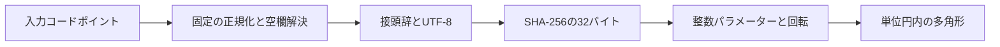

# ユニット名と円形紋章の版1規約

## 適用範囲

この規約は表示専用であり、名前と紋章をユニットの識別子、照合キーと唯一性の保証に使わない。\
戦闘は既存のid、campと枠番号、対象の配列番号を使う。
同名は許可し、同じ名前と方式の版は同じ紋章になる。
将来別端末へ渡す表示用データは、空欄を解決したnameとidenticon_versionの組とする。\
今回は送受信とアカウント、共有機能を実装しない。

## 名前の正規化

StringをUnicodeコードポイントの列として扱う。
次の順序を固定する。

1. 下表の空白をASCII空白U+0020へまとめ、連続空白と前後空白を除く。
2. 下表の除去対象を読み飛ばす。
3. 正規化した列の先頭32コードポイントまでを残し、最後が空白なら除く。
4. 大文字小文字、Unicodeの合成と分解、結合文字、絵文字の接続文字は変換しない。

| 対象 | コードポイント |
| --- | --- |
| 空白 | U+0009からU+000D、U+0020、U+0085、U+00A0、U+1680、U+2000からU+200A、U+2028、U+2029、U+202F、U+205F、U+3000 |
| 空白処理後の除去 | U+0000からU+001F、U+007FからU+009F、U+061C、U+200B、U+200E、U+200F、U+202AからU+202E、U+2060、U+2066からU+2069、U+FEFF |

32は書記素数ではなくコードポイント数である。\
結合文字と絵文字の複数コードポイントもそれぞれ数える。
正規化後の空文字は自動名を表し、下表から枠の既定名へ解決してからハッシュへ渡す。

| 不変枠 | 既定名 |
| --- | --- |
| PLAYER 01 | Kestrel |
| PLAYER 02 | Vesper |
| PLAYER 03 | Lyra |
| ENEMY A | Onyx |
| ENEMY B | Cipher |
| ENEMY C | Sable |

ユーザー入力はLineEditと通常の文字列描画で扱い、装飾タグとして解析しない。\
入力中は編集バッファを保持して正規化した状態だけをプレビューし、EnterとTab、フォーカス退出で欄を整える。
Escはそのフォーカスでの編集開始時へ戻す。
長い入力は欄内で横スクロールし、保存と表示の値には最初の32コードポイントだけを使う。
表示フォントは既存のフォールバックを使い、紋章の生成へフォントを使わない。

## ハッシュ

方式の版は整数1である。
バイト列はASCIIの接頭辞PHASE/identicon/v1とLF1バイト、その後に解決した正規化名のUTF-8を連結したものとする。\
BOMと終端ゼロは付けず、SHA-256の32バイトを使う。
16進表示は小文字とする。

| 名前 | SHA-256 |
| --- | --- |
| Aster | 14cc16f47046a92573e5e2212de006cf70ee7ccbbcf325b6c15d7e6b237ca5b0 |
| 星屑 | 4567b521a7020c6ba22eff69d428267de39000b2faff6708196f66465f8835d8 |

## 幾何の固定規約

ハッシュのバイトを先頭からh[0]とする。
すべて非負の整数として扱い、剰余は通常の非負整数の剰余とする。

| パラメーター | 値 |
| --- | --- |
| family | h[0] mod 6 |
| 反復数n | [4,3,2][family mod 3] |
| 回転番号q | h[1] mod 8 |
| 幅w | 12 + 4*(h[2] mod 3) |
| 内側r | 20 + 6*(h[3] mod 3) |
| 中央のひし形 | h[4]の最下位ビットが1のときだけ追加 |

familyが0から2なら、基礎多角形は(r,0)、(42,-w)、(60,0)、(42,w)の順とする。
familyが3から5なら、(r,-w)、(48,-w)、(60,0)、(48,w)、(r,w)、(r+3*w/4,0)の順とする。
閉じる辺は最後から最初へ結ぶ。

整数回転R((x,y),(c,s))=(x*c-y*s,x*s+y*c)を使う。
反復数ごとの行列係数を下表から順に適用し、さらにqの全体回転を適用して、各座標を64*1024*1024で割る。

| n | 反復回転の(c,s) |
| --- | --- |
| 2 | (1024,0)、(-1024,0) |
| 3 | (1024,0)、(-512,887)、(-512,-887) |
| 4 | (1024,0)、(0,1024)、(-1024,0)、(0,-1024) |

qの全体回転は順に(1024,0)、(724,724)、(0,1024)、(-724,724)、(-1024,0)、(-724,-724)、(0,-1024)、(724,-724)とする。
中央のひし形は(0,-8)、(8,0)、(0,8)、(-8,0)へqだけを適用し、64*1024で割る。
これにより全点は単位円内となる。

| 名前 | family、n、q、w、r、中央 |
| --- | --- |
| Aster | 2、2、4、16、26、なし |
| 星屑 | 3、4、7、16、20、あり |

得られた多角形を必要な半径へ拡縮し、単色で塗り、同色の細いアンチエイリアス境界を付ける。\
外周の追加円、発光、画像素材は使わない。
描画半径とインクの濃さ、最小物理線幅は表示の調整値であり、方式の幾何には含めない。\
端末間で同じ幾何を再構成する約束であり、異なるGPUの全画素の一致は要求しない。

## 保存と表示

現行の新規保存はversion=3、identicon_version=1とし、3つのunit_namesを構成と独立して持つ。\
所属設定はdocs/assembly-v1.mdの別項目であり、この版1のユニット図形を変更しない。
各名前は正規化済みの文字列であり、自動名を表す空文字も保存できる。\
不正な名前と未知版、欠落は現在状態を変更せず拒否し、旧保存の移行と自動上書きはしない。
紋章の頂点や画像は保存せず、名前と版から再生成する。

盤面の芯は紋章だけとし、所属の設定色と自軍だけの控えめな所属色マークで陣営を示す。
戦闘と入力欄以外の識別は紋章と所有マーク、既存の対応強調を使い、ユニット名は表示しない。\
幅の広いUnicode合字で2行に収まらない場合だけ文字を縮小し、他の情報へ重ねない。\
同名と形の衝突は起こり得るため、名前やハッシュから対象を検索してはならない。
