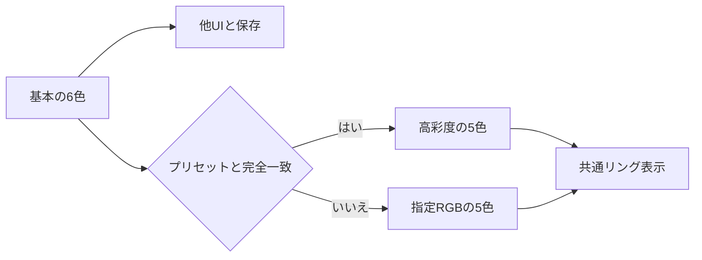

# 設計

## 背景と制約

- 提案: [proposal.md](proposal.md)
- 前提: openspec/tech.md の 表示原則、openspec/structure.md の 配置原則。
- 基準は33823c9であり、追跡ファイルに変更はなかった。
- 既存の6色はリング以外の数値、波形、部品にも使われるため、基本色そのものは変更しない。

## 設計判断

### D-01 - プリセットの表示用配色

- 選択: 基本の6色が組み込みプリセットと完全一致するときだけ、リング用の5色を派生する。\
  色相とHSVのVを保ち、彩度Sを1-pow(1-S,p)へ高める。\
  アクセント、基本色、他UI、HP白線は変更しない。
- 理由: 色分類と暗い画面を維持し、リングだけを鮮やかにできる。
- 代替案: PRESETS自体のRGBを変える方法は他UIへ広がるため採用しない。
- 昇格: openspec/tech.md の 表示原則
- 値: 彩度の乗数2.0をgame/tuning.gdのUNIT_RING_SATURATION_POWERに定義する。\
  全プリセットの派生色が既存の判読性と区別の基準を満たすことを検査する。

### D-02 - カスタムと保存の保持

- 選択: 6色がプリセットと一致しない場合は、アクセントだけの変更を含めてカスタムとし、5色のRGBをそのまま使う。\
  保存形式は6色の配列のままとし、読み込みと描画で書き戻さない。
- 理由: カスタムの意図を推測で変更せず、既存データに移行を要求しない。
- 代替案: カスタムの彩度も自動で変える方法、過去の保存を新しい色へ書き換える方法は採用しない。
- 昇格: openspec/tech.md の 表示原則

### D-03 - 全リングへの接続

- 選択: 基本のstatus_colorsと派生したring_colorsを分け、共通のリング呼出しにだけ後者を渡す。\
  色設定の既存説明1行だけをプリセットとカスタムの違いへ置き換える。
- 理由: 盤面、TURN ORDER、詳細、予測、BUILDの3リングを揃え、配置や線幅を変えずに済む。
- 代替案: 各画面に変換を重複させたり、新しい操作部品を増やしたりしない。
- 昇格: なし

## 検証計画

| シナリオID | 設計判断 | 検証方法 |
| --- | --- | --- |
| REQ-032-S01 | D-01 | 自動テスト |
| REQ-032-S02 | D-02 | 自動テスト |
| REQ-032-S03 | D-01、D-02、D-03 | 自動テスト |
| REQ-032-S04 | D-01、D-02、D-03 | 実機確認 |

彩度と色相、明度、カスタムRGBは配色部品で確認し、UIでは適用と保存保持の接続だけを代表例で確認する。\
入力の異常系と保存失敗は既存の配色部品の検査を継続し、同じ条件を繰り返さない。\
各画面の実表示と色分類、背景との区別は既定とAMBERとカスタム、基準と最小の画像で確認する。\
同じTURN2の比較ではリング領域以外の画素が変わらないことと、白いHPと形状の維持を確認する。

## リスクと移行

保存済みの配色も6色がプリセットと一致すれば鮮やかなリングになり、それ以外は完全なカスタム色を維持する。\
色設定にはプリセットのリング強調とカスタム色保持を簡潔に示す。\
既存の保存と設定、過去の画像を上書きせず、新しい画像をLibraryへ保存する。\
移行は不要であり、当該UI変更のrevertで復旧できる。
