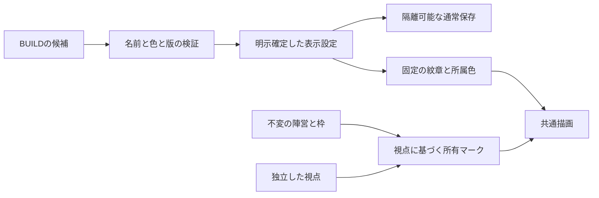

# 設計

## 背景と制約

提案は[proposal.md](proposal.md)、表示設定と識別の分離はopenspec/tech.mdの技術上の判断基準を参照する。
既存の編集対象はPLAYERのアセンブリと3枠であり、敵構成を編集する新しいモードは作らない。

## 設計判断

### D-01 - アセンブリ設定を戦闘から分離する

- 選択: collectionへ名前、色キー、版のassemblyを保存し、相手の表示設定とview_campはUIが独立して持つ。
- 理由: 陣営と枠、CPUと対象を変更せず、将来同色と同紋章の相手を表示できる。
- 代替案: 名前と紋章をIDへ流用する案、衝突時の図形と色の変更、戦闘ユニットへの配色保存は採らない。
- 昇格: openspec/tech.md の 技術上の判断基準

### D-02 - 別の紋章規約と安定した色キー

- 選択: 名前は版1の正規化を再利用し、空欄はORBIT、敵はVECTORとする。
  紋章は別接頭辞PHASE/assembly/v1と改行、UTF-8、SHA-256、4つの太い幾何図案と整数回転を版1として定義する。
  既存ユニットの生成規約と形を変更せず、設定色を描画の別引数で渡す。
- 理由: 名前を送れば同じ図形を再構成でき、ユニットとは線の太さと図案で区別できる。
- 代替案: 画像保存、外部API、乱数、既存のユニット用504形の改変は採らない。
- 昇格: openspec/structure.md の 配置原則

### D-03 - HPの色相と高い明度を分ける

- 選択: PEARL、JADE、ICE、AMBER、LILAC、ROSEの6キーを使い、PLAYERの既定はJADE、敵はAMBERとする。
  紋章は選択色、HPは同じ色相で彩度を0.35倍、明度を1とする。
  HPの相対輝度は0.85以上、暗い効果セルに対するコントラストは15以上を確認する。
  表示の係数と基準はgame/tuning.gdの1か所へ置き、パレットの安定したRGBは版付きの規約へ置く。
- 理由: 所属の色を保ちつつ、細いHPの視認性を白に近い明度で保つ。
- 代替案: 暗い設定色のHPへの直接使用、ステータス用配色との混在、攻撃と回復の色の変更は採らない。
- 昇格: openspec/tech.md の 表示原則

### D-04 - コンパクトな編集と共有のHP列

- 選択: BUILDの共有情報行の右側へ名前と紋章の入口を置き、専用の小さい補助画面で名前と6色、即時プレビュー、明示確定と取消を提供する。
  名前の編集中は原本を変えず、Enterは入力を整え、Escは補助画面を閉じる。
  陣営HPの両行は最も長い数値の幅から共通列を求め、紋章、バーと文字の垂直中心を同じ高さとする。
  紋章の半径と線幅、列と余白はgame/tuning.gdへ置き、初期の半径は16、輪郭は1とする。
- 理由: 既存の3列BUILDと大きいマップを変えず、長い名前とHPで片方だけ列が動くことを防ぐ。
- 代替案: BUILD全体の再設計、両陣営で独立した数値の左端計算、入力中の保存は採らない。
  右詳細の上部へ所属紋章を置き、クラス以降の位置と順序を維持する。
  戦闘の名前と自動生成するP1とE1形式は表示せず、行動と対象、目的文は現在の構成の紋章で識別する。
  時間軸の相対待ち量とHP、装備と効果は維持し、名前は入力と保存、生成、非表示のアクセシビリティ用名称に保持する。
  利用者の名前を検閲せず、同名の対応は既存の選択とホバーで示す。
- 昇格: なし

### D-05 - 所有マークを視点から判定する

- 選択: view_campの既定はPLAYERとし、その陣営と整合した不変IDだけへ同心円のマークを描く。
  マス左下の従来領域でフォーカス枠を避ける位置を使い、中心から(-38,38)、半径4、白灰色、最小物理線幅をgame/tuning.gdへ置く。
- 理由: 同色と同紋章でも自軍だけを示し、手番とホバーの既存フォーカス枠とは意味を分けられる。
- 代替案: 名前による判定、敵にも出す番号、追加の点滅と色分けは採らない。
- 昇格: openspec/tech.md の 表示原則

### D-06 - 新規保存と一時データの境界

- 選択: 保存版3にassemblyを必須化し、未知の色キーと版、不正な名前を拒否する。
  旧保存の移行は作らず、全解放の設定は一時collection内に保持して通常状態を復元する。
- 理由: 通常と検証、将来送る表示設定の境界を明確にする。
- 代替案: 独立UI設定への混在、実保存の変換と自動上書きは採らない。
- 昇格: openspec/tech.md の 技術上の判断基準

## 検証計画

| シナリオID | 設計判断 | 検証方法 |
| --- | --- | --- |
| REQ-019-S01 | D-01、D-02、D-03、D-04、D-05、D-06 | 実機確認 |
| REQ-019-S03 | D-01、D-02、D-03、D-04、D-05、D-06 | 自動テスト |
| REQ-019-S04 | D-01、D-02、D-03、D-04、D-05、D-06 | 自動テスト |
| REQ-019-S05 | D-01、D-02、D-03、D-04、D-05、D-06 | 自動テスト |
| REQ-019-S06 | D-01、D-02、D-03、D-04、D-05、D-06 | 自動テスト |
| REQ-019-S07 | D-01、D-02、D-03、D-04、D-05、D-06 | 自動テスト |
| REQ-019-S08 | D-01、D-02、D-03、D-04、D-05、D-06 | 自動テスト |
| REQ-019-S09 | D-01、D-02、D-03、D-04、D-05、D-06 | 自動テスト |
| REQ-019-S10 | D-01、D-02、D-03、D-04、D-05、D-06 | 自動テスト |
| REQ-019-S11 | D-01、D-02、D-03、D-04、D-05、D-06 | 自動テスト |
| REQ-019-S12 | D-01、D-02、D-03、D-04、D-05、D-06 | 自動テスト |
| REQ-019-S13 | D-01、D-02、D-03、D-04、D-05、D-06 | 実機確認 |
| REQ-019-S14 | D-01、D-02、D-03、D-04、D-05、D-06 | 自動テスト |
| REQ-021-S01 | D-01、D-02、D-03、D-04、D-05、D-06 | 実機確認 |
| REQ-021-S04 | D-01、D-02、D-03、D-04、D-05、D-06 | 自動テスト |
| REQ-021-S05 | D-01、D-02、D-03、D-04、D-05、D-06 | 実機確認 |
| REQ-021-S06 | D-01、D-02、D-03、D-04、D-05、D-06 | 自動テスト |
| REQ-021-S07 | D-01、D-02、D-03、D-04、D-05、D-06 | 実機確認 |
| REQ-030-S01 | D-01、D-02、D-03、D-04、D-05、D-06 | 自動テスト |
| REQ-030-S02 | D-01、D-02、D-03、D-04、D-05、D-06 | 自動テスト |
| REQ-030-S03 | D-01、D-02、D-03、D-04、D-05、D-06 | 実機確認 |
| REQ-030-S04 | D-01、D-02、D-03、D-04、D-05、D-06 | 自動テスト |
| REQ-032-S01 | D-01、D-02、D-03、D-04、D-05、D-06 | 自動テスト |
| REQ-032-S02 | D-01、D-02、D-03、D-04、D-05、D-06 | 自動テスト |
| REQ-032-S03 | D-01、D-02、D-03、D-04、D-05、D-06 | 自動テスト |
| REQ-032-S04 | D-01、D-02、D-03、D-04、D-05、D-06 | 実機確認 |
| REQ-031-S01 | D-01、D-02、D-03、D-04、D-05、D-06 | 自動テスト |
| REQ-031-S03 | D-04 | 自動テスト |
| REQ-031-S02 | D-01、D-02、D-03、D-04、D-05、D-06 | 自動テスト |
| REQ-016-S01 | D-01、D-02、D-03、D-04、D-05、D-06 | 自動テスト |
| REQ-016-S02 | D-01、D-02、D-03、D-04、D-05、D-06 | 自動テスト |
| REQ-049-S01 | D-04 | 自動テスト |
| REQ-049-S02 | D-04 | 実機確認 |
| REQ-048-S01 | D-01、D-02、D-03、D-04、D-05、D-06 | 自動テスト |
| REQ-048-S02 | D-01、D-02、D-03、D-04、D-05、D-06 | 実機確認 |
| REQ-050-S01 | D-01、D-02、D-03、D-04、D-05、D-06 | 自動テスト |
| REQ-050-S02 | D-01、D-02、D-03、D-04、D-05、D-06 | 自動テスト |
| REQ-051-S01 | D-01、D-02、D-03、D-04、D-05、D-06 | 自動テスト |
| REQ-051-S02 | D-01、D-02、D-03、D-04、D-05、D-06 | 自動テスト |
| REQ-051-S03 | D-01、D-02、D-03、D-04、D-05、D-06 | 実機確認 |
| REQ-052-S01 | D-01、D-02、D-03、D-04、D-05、D-06 | 自動テスト |
| REQ-052-S02 | D-01、D-02、D-03、D-04、D-05、D-06 | 実機確認 |

紋章規約と色、所有と保存の基本規則は部品で確かめ、画面では接続と取消、共通列の対応だけを確認する。
同じ判断の多段検査とバランスに依存した固定値を増やさない。
既存の正常と不正保存の検査へ新しい項目を接続し、旧移行のケースは作らない。

## リスクと移行

同色と同紋章は許容し、形と色を後から変更しない。
小さい紋章と明るいHP、所有マークの可読性は実描画と利用者の最終確認を分ける。
通信と旧保存の移行は行わず、実セーブと設定、既存成果物を変更しない。
MacのロックでOS操作ができない場合は、操作を伴わないGodot描画と自動検査を継続し、物理操作は未確認として残す。
