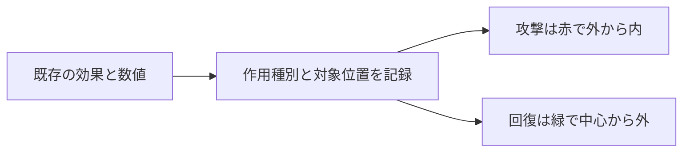

# 設計

## 背景と制約

- 提案: [proposal.md](proposal.md)
- 前提: openspec/tech.md の 表示原則とテスト方針。

## 設計判断

### D-01 - 攻撃の時間と形を維持する

- 選択: 3本、時間差0.06秒、各0.30秒、全体0.42秒と線幅、減衰、外形の切り取りは12d9b91のままにし、色だけを変える。
- 理由: 利用者が受け入れた攻撃の感触を変えない。
- 代替案: 共通の動きを反転して両方を調整する案は採らない。
- 昇格: なし

### D-02 - 回復の内側を最初から見せる

- 選択: 回復は対象外周の0.12倍から外周の1.9倍へ、進行の1.4乗でゆっくり立ち上げて広がる。対象だけは円全体の外形除外を外し、名前の矩形だけを保護して文字、HPとリングを従来の前面に描く。他者の外形除外は維持する。
- 理由: 外周まで隠れた円の色を変えるだけにせず、内側から出ていくことを読める。
- 代替案: 対象全体の円盤マスクを残す案は中心の発生を隠すため採らない。
- 昇格: なし

### D-03 - 既存の配色と表示用の明度

- 選択: 既存のINFとRESのリング表示色を使い、組み込みプリセットだけ最低明度0.97へ上げる。カスタム色のRGBはそのまま使う。追加の調整値はgame/tuning.gdの1か所へ置く。
- 理由: 赤と緑の彩度と明度を保ち、既存の配色設定と保存を尊重する。
- 代替案: 固定色で設定を無視する案と発光は採らない。
- 昇格: なし

## 検証計画

| シナリオID | 設計判断 | 検証方法 |
| --- | --- | --- |
| REQ-021-S01 | D-01 | 実機確認 |
| REQ-021-S04 | D-01、D-02 | 自動テスト |
| REQ-021-S05 | D-01、D-02、D-03 | 実機確認 |

S04の方向と発生半径は既存の描画部品の検査を拡張し、種別と即時適用は既存UI接続で確認する。
モデルの戦闘計算と保存の検査を重ねず、固定バランス期待値を足さない。
通常速度の同じ2手、内側の初期フレームと外側のフレームを実GPUで確認する。

## リスクと移行

中心からの円は文字とHPより下に置き、両方の可読性を確認する。
対象が後から移動する場合は新しい位置を保護し、円の中心を移動させない。
基準2コミットと実データ、過去成果物は保持する。
保存形式と演出の処理待ちは変更しない。
