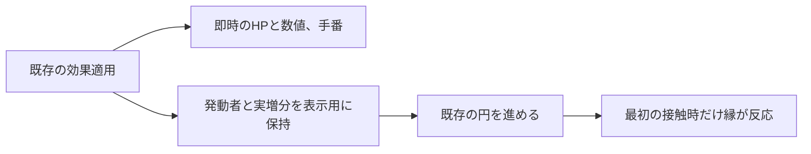

# 設計

## 背景と制約

- 提案: [proposal.md](proposal.md)
- 前提: openspec/tech.md の 表示原則とテスト方針。

## 設計判断

### D-01 - 表示時刻だけで1回反応する

- 選択: 攻撃は最初の円の既存の収束終点へ達する0.30秒時点、回復は既存の半径式を逆算してHP円弧を横切る時点を開始にする。\
  攻撃は0.12秒、回復は0.18秒で1回だけ減衰する。\
  調整値はgame/tuning.gdへ置く。
- 理由: 円の形と速度、HPと数値の処理を変えず、同じ表示寿命の中で終えられる。
- 代替案: 接触まで戦闘処理を遅らせる案と、各円ごとの点滅は採らない。
- 昇格: なし

### D-02 - 保存しない最小の反応情報

- 選択: 既存の発動者番号をフィードバックへ渡し、最終INF補正160%以上だけ少し強くする。\
  回復範囲は確定後HPと実回復量から求め、実増分がなければ反応しない。
- 理由: 次の手番のユニットを参照せず、上限を超えた分を表示しない。
- 代替案: 履歴文字列の解析と戦闘データ形式への表示項目追加は採らない。
- 昇格: なし

### D-03 - 外縁と白いHPの芯だけを守る

- 選択: 攻撃は装備リングのすぐ外の白い細線で、通常は透明度0.70と幅1.35px、高INFは0.98と1.85pxとする。\
  回復は増分区間だけに幅3.4px、透明度0.55の淡い縁を白いHPより下へ描く。\
  描画用の数値はtuning.gdへ集約する。
- 理由: 名前とHPを覆わず、撃破後も本体ではなく最後の外縁だけを残せる。
- 代替案: 全リングの白塗りとユニット本体の復活、大きな閃光は採らない。
- 昇格: openspec/tech.md の 表示原則

## 検証計画

| シナリオID | 設計判断 | 検証方法 |
| --- | --- | --- |
| REQ-021-S01 | D-01 | 実機確認 |
| REQ-021-S04 | D-01、D-02 | 自動テスト |
| REQ-021-S05 | D-01、D-03 | 実機確認 |
| REQ-021-S06 | D-01、D-02、D-03 | 自動テスト |
| REQ-021-S07 | D-03 | 実機確認 |
S06の時刻と円弧範囲は描画部品で、発動者と実増分の接続は既存のUI検査で確認する。\
同じ判断をモデルで重ねず、ダメージと回復量の固定期待値は足さない。\
最小と標準、通常と高INF、撃破と盤端、回復増分は実GPUで確認する。

## リスクと移行

撃破で対象が消えても、保持した位置へ外縁だけを描く。\
回復の淡い縁は名前の保護と他者の外形の切り取りを使い、白いHPの芯を前面に保つ。\
既存の表示寿命と退出処理を維持し、保存形式と3つの基準は変更しない。
