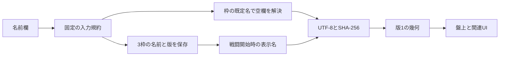

# 設計

## 背景と制約

提案は[proposal.md](proposal.md)、モデルと表示の分離はopenspec/tech.mdを参照する。
既存の編集対象はPLAYERの3枠だけであり、敵構成と名前は固定とする。

## 設計判断

### D-01 - 表示名を構成と不変IDから分ける

- 選択: collectionのunit_namesに3つの名前を保存し、戦闘開始時にdisplay_nameとして渡す。
- 理由: 装備の構成検証と不変ID、対象番号、同値時の順を変更せず、同名を許せる。
- 代替案: idの改名と名前による検索、装備ビルドへの混在は採らない。
- 昇格: openspec/tech.md の 技術上の判断基準

### D-02 - 版1の入力と幾何を固定する

- 選択: 最大32コードポイント、固定空白と制御の処理、空欄の枠ごとの解決、UTF-8と固定接頭辞によるSHA-256を版1として定義する。
- 理由: OSの文字列ハッシュと乱数、フォント、時刻へ依存せず、同じ名前と版から再構成できる。
- 代替案: OS任せの正規化、色だけのドット模様と画像保存は採らない。
- 昇格: docs/identicon-v1.mdの規約とopenspec/tech.mdの表示原則

### D-03 - 少数の形をリングの内側へ収める

- 選択: 六つのモチーフ群、八方向、幅と内側の余白をハッシュで決め、2から4形と任意の中央ひし形を単色で描く。
- 理由: 白いHPと位相色を維持し、小さい芯を円形の幾何として読める。
- 代替案: 外周の追加リング、派手な発光と外部素材は採らない。
- 昇格: openspec/tech.md の 表示原則

### D-04 - 長い名前と編集の入力を限定する

- 選択: NAME欄は入力中に値と紋章を更新し、Enterとフォーカス退出で整形、Escで編集開始時へ戻す。\
  詳細は2行以内で全文を描き、幅の広いUnicode合字だけ文字を縮小する。
- 理由: 前後空白を各打鍵で消して複数語やIMEの入力を妨げず、保存する値は常に規約内となる。
- 代替案: 1文字ごとのUI再構築と、盤面への長い名前の描画は採らない。
- 昇格: なし

### D-05 - 新しい保存形式だけを扱う

- 選択: 保存版2にunit_namesとidenticon_versionを必須化し、旧2体とSTOP FIELDの移行だけを除去する。
- 理由: 利用者が旧保存の引き継ぎを不要とし、今回は移行を作らないためである。
- 代替案: 読込時に欠落名を補って旧保存を受け入れる案は採らない。
- 昇格: openspec/tech.md の 技術上の判断基準

## 検証計画

| シナリオID | 設計判断 | 検証方法 |
| --- | --- | --- |
| REQ-030-S01 | D-02、D-03 | 自動テスト |
| REQ-030-S02 | D-02、D-03 | 自動テスト |
| REQ-030-S03 | D-02、D-03 | 実機確認 |
| REQ-030-S04 | D-02、D-03 | 自動テスト |
| REQ-031-S01 | D-01、D-04 | 自動テスト |
| REQ-031-S02 | D-01、D-04 | 自動テスト |
| REQ-044-S01 | D-01、D-05 | 自動テスト |
| REQ-016-S01 | D-01、D-05 | 自動テスト |
| REQ-016-S02 | D-01、D-05 | 自動テスト |
| REQ-026-S01 | D-01、D-05 | 自動テスト |
| REQ-026-S02 | D-01、D-05 | 自動テスト |
| REQ-026-S03 | D-01、D-05 | 自動テスト |
| REQ-026-S04 | D-01、D-05 | 自動テスト |
| REQ-026-S05 | D-01、D-05 | 自動テスト |
| REQ-043-S01 | D-01、D-05 | 自動テスト |
| REQ-043-S02 | D-01、D-05 | 自動テスト |
| REQ-043-S03 | D-01、D-05 | 自動テスト |
| REQ-043-S04 | D-01、D-05 | 実機確認 |
| REQ-047-S01 | D-02 | 自動テスト |
| REQ-048-S01 | D-02、D-03 | 自動テスト |
| REQ-048-S02 | D-02、D-03 | 実機確認 |
| REQ-049-S01 | D-01、D-04 | 自動テスト |
| REQ-049-S02 | D-01、D-04 | 実機確認 |
入力とハッシュ、幾何、保存と同名の判定は下層で、UIは編集と接続だけを確認する。
固定ベクトルは独立したSHA-256計算から作り、戦闘バランスの固定値は足さない。

## リスクと移行

同名と紋章の衝突を識別子として使わず、陣営と枠の参照を残す。
名前はプレーンテキストとし、長い名前はタイムラインと操作で省略、右詳細で全文を表示する。
既存のシステムフォントの範囲でUnicodeを表示し、OSのIMEと別端末の描画は確認範囲を分ける。
実保存へ触れず、隔離した新規保存と実Godotの再起動で検証する。
