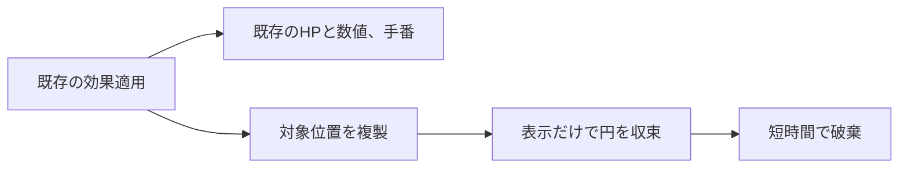

# 設計

## 背景と制約

- 提案: [proposal.md](proposal.md)
- 前提: openspec/tech.md の 表示原則とテスト方針。

## 設計判断

### D-01 - 既存の結果へ表示だけを重ねる

- 選択: 既存の_feedbackで攻撃と回復の発生位置を複製して記録し、表示時間だけを進める。モデル、操作待ちとCPUの段階を変えない。
- 理由: HPと数値、撃破を遅らせず、撃破後も中心を保持でき、小さな差分で試せる。
- 代替案: 前回の発動待ちと飛行状態は復活させない。
- 昇格: なし

### D-02 - リングへ向かう細い円

- 選択: 3本を0.06秒ずつずらし、各0.30秒で外周の約1.9倍からリング直前へ縮める。全体0.42秒、灰色、線幅1.35論理px、最小1物理pxとする。game/tuning.gdの1か所に定義する。
- 理由: 中心とHPの輪郭を隠さず、通常速度で複数の円が内側へ移ることを読める。
- 代替案: 中央の名前まで横断する円と発光は使わない。
- 昇格: なし

### D-03 - 既存の識別を前面に保つ

- 選択: 雲の後、パネルとユニット、フォーカスと数値より前に描く。盤外と生存ユニットの外形に入る線分は描かない。移動者は実描画の補間中心を使って避ける。
- 理由: 独立した同心円として読め、既存の状態と混同させない。
- 代替案: UIより上のオーバーレイと専用の粒子素材は使わない。
- 昇格: なし

## 検証計画

| シナリオID | 設計判断 | 検証方法 |
| --- | --- | --- |
| REQ-021-S01 | D-01 | 実機確認 |
| REQ-021-S04 | D-01、D-02 | 自動テスト |
| REQ-021-S05 | D-02、D-03 | 実機確認 |

S04の時刻と半径、盤面と外形は描画部品、効果適用と退出はUIの接続で確認する。
同じ判断をモデルで繰り返さず、威力と勝敗の固定期待値は追加しない。
最小と標準、通常速度の動画と途中フレームで開発側の描画を確認する。

## リスクと移行

終局でも既存のRESULTを即時に開き、円のために表示や計算を待たせない。
円の寿命は対象の生存へ依存させず、画面と所有戦闘の変更で破棄する。
保存移行はない。
f779184を動かさず、試作コミットだけを打ち消せるようにする。
