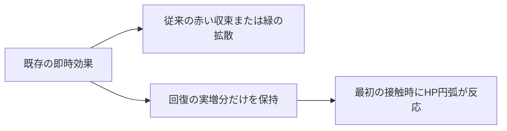

# 設計

## 背景と制約

提案は[proposal.md](proposal.md)を参照する。
表示の責務とテスト方針はopenspec/tech.mdに従う。

## 設計判断

### D-01 - 攻撃専用の分岐を削除する

- 選択: 反応の幾何は回復だけを返し、攻撃専用定数、高INF判定と発動者情報を削除する。
- 理由: 通常と高INF、撃破後の白縁を同時に除去し、無効な機能を残さない。
- 代替案: 透明度をゼロにするだけの無効化は採らない。
- 昇格: openspec/tech.md の 表示原則

### D-02 - 回復と既存円をそのまま保つ

- 選択: 実HP増分の情報と回復の半径式、時刻、色、幅と減衰、既存の円の計算を維持する。
- 理由: 回復と戦闘計算の変更を混ぜない。
- 代替案: 9882aa6全体の取り消しは採らない。
- 昇格: なし

## 検証計画

| シナリオID | 設計判断 | 検証方法 |
| --- | --- | --- |
| REQ-021-S01 | D-02 | 実機確認 |
| REQ-021-S04 | D-02 | 自動テスト |
| REQ-021-S05 | D-02 | 実機確認 |
| REQ-021-S06 | D-01、D-02 | 自動テスト |
| REQ-021-S07 | D-01、D-02 | 実機確認 |

S06は表示幾何の部品で、S04は既存の効果への接続で検証する。
回復の固定量と戦術の固定期待値は追加しない。

## リスクと移行

保存形式は変更しない。
実データと過去の成果物は保存し直さず、新規の検証先を使う。
