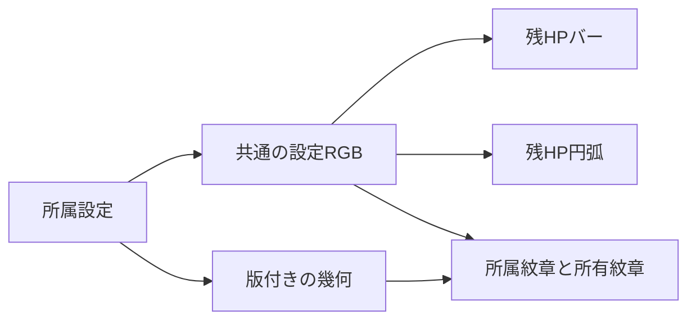

# 設計

## 背景と制約

提案は[proposal.md](proposal.md)、表示と識別の分離はopenspec/tech.mdの表示原則を参照する。
既存の設定色、図形と所有の判定を表示へ一貫して渡す。

## 設計判断

### D-01 - 設定RGBを共有する

- 選択: 設定色の取得だけを残し、残HPの別トーンと輝度補正を廃止する。
  残HPバー、残HP円弧、所属紋章と所有紋章へ同じ不透明のRGBを渡す。
  背景と減少部分、実回復増分の一時反応は既存の表示を維持する。
- 理由: 同じ設定に別の明度と彩度、透明度を持たせず、所属の色を統一する。
- 代替案: 高明度化と透過、色の複製定義は採らない。
- 昇格: openspec/tech.md の 表示原則

### D-02 - 所有に実際の紋章を使う

- 選択: 所有判定を保ち、自軍だけに既存の所属紋章描画を使う。
  中心のオフセットは(-38,38)を保ち、半径はgame/tuning.gdで4から6へ調整して形を読めるようにする。
  同心円と専用の透過、内円、線幅の調整値を廃止する。
- 理由: 紋章の決定規則を変えず、中心のユニットと手番枠を避けた小さい図案にする。
- 代替案: 新しい所有図案、敵のマーク、衝突回避による図形変更は採らない。
- 昇格: openspec/tech.md の 表示原則

### D-03 - 数値を右へ揃えてバーを広げる

- 選択: game/tuning.gdの共通右端360とフォント、バー左端96、紋章とバーの間隔12を維持する。
  各数値はその文字幅を右端から引いて配置し、バーは2行の最大文字幅と既存の間隔16を確保した同じ幅とする。
  左寄せの上限だった調整値を廃止する。
- 理由: 通常の桁でバーを長くし、大きい桁でも余白と共通右端を保つ。
- 代替案: 陣営ごとの異なるバー幅、文字の縮小、切り上げと比率の変更は採らない。
- 昇格: なし

## 検証計画

| シナリオID | 設計判断 | 検証方法 |
| --- | --- | --- |
| REQ-019-S01 | D-01、D-02、D-03 | 実機確認 |
| REQ-019-S03 | D-01、D-02、D-03 | 自動テスト |
| REQ-019-S04 | D-01、D-02、D-03 | 自動テスト |
| REQ-019-S05 | D-01、D-02、D-03 | 自動テスト |
| REQ-019-S06 | D-01、D-02、D-03 | 自動テスト |
| REQ-019-S07 | D-01、D-02、D-03 | 自動テスト |
| REQ-019-S08 | D-01、D-02、D-03 | 自動テスト |
| REQ-019-S09 | D-01、D-02、D-03 | 自動テスト |
| REQ-019-S10 | D-01、D-02、D-03 | 自動テスト |
| REQ-019-S11 | D-01、D-02、D-03 | 自動テスト |
| REQ-019-S12 | D-01、D-02、D-03 | 自動テスト |
| REQ-019-S13 | D-01、D-02、D-03 | 実機確認 |
| REQ-019-S14 | D-01、D-02、D-03 | 自動テスト |
| REQ-019-S15 | D-01、D-02、D-03 | 自動テスト |
| REQ-021-S01 | D-01、D-02、D-03 | 実機確認 |
| REQ-021-S04 | D-01、D-02、D-03 | 自動テスト |
| REQ-021-S05 | D-01、D-02、D-03 | 実機確認 |
| REQ-021-S06 | D-01、D-02、D-03 | 自動テスト |
| REQ-021-S07 | D-01、D-02、D-03 | 実機確認 |
| REQ-030-S01 | D-01、D-02、D-03 | 自動テスト |
| REQ-030-S02 | D-01、D-02、D-03 | 自動テスト |
| REQ-030-S03 | D-01、D-02、D-03 | 実機確認 |
| REQ-030-S04 | D-01、D-02、D-03 | 自動テスト |
| REQ-032-S01 | D-01、D-02、D-03 | 自動テスト |
| REQ-032-S02 | D-01、D-02、D-03 | 自動テスト |
| REQ-032-S03 | D-01、D-02、D-03 | 自動テスト |
| REQ-032-S04 | D-01、D-02、D-03 | 実機確認 |
| REQ-050-S01 | D-01、D-02、D-03 | 自動テスト |
| REQ-050-S02 | D-01、D-02、D-03 | 自動テスト |
| REQ-052-S01 | D-01、D-02、D-03 | 自動テスト |
| REQ-052-S02 | D-01、D-02、D-03 | 実機確認 |

設定色の完全な集合は部品、円弧の色と比率は共通描画で確かめる。
画面ではバーと所有紋章への接続、共通列と右端だけを代表の例で確認する。
既存のバランスに依存しない検査を使い、勝敗と手数の期待値は追加しない。

## リスクと移行

設定RGBを変えないため、視認性は線の形と大小の実描画で確認する。
同色の両陣営でも自軍のマークの有無を確認し、実データと既存成果物を保護する。
保存と図形の版、既定色は変えず、移行は行わない。
