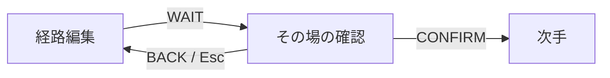

# 設計

## 背景と制約

- 提案: [proposal.md](proposal.md)
- 前提: openspec/tech.md の 技術上の判断基準、テスト方針、表示原則

## 設計判断

### D-01 - 移動状態で能動行動を制限する

- 選択: WAITはMOVEとCHOICEで許可し、能動行動の選択、効果予測と実行は実移動数が正の場合だけ許可する。
- 理由: 対象の幾何判定を変えず、UIとCPUの入口で同じ制約を守れる。
- 代替案: 対象判定自体に移動制約を加えると、移動前の脅威評価まで変わるため採用しない。
- 昇格: openspec/tech.md の 技術上の判断基準

### D-02 - その場の予定を明示する

- 選択: 右側の既存操作位置へWAITを常設し、独立した空経路の予定からCONFIRMへ進む。確認中は空の予定経路を描き、取消は元の未確定経路へ戻す。
- 理由: 閉塞時も同じ操作で進め、未確定の移動を誤って適用しない。
- 代替案: 即時WAITは既存の誤操作防止を失うため採用しない。
- 昇格: なし

調整値の追加はない。

## 検証計画

| シナリオID | 設計判断 | 検証方法 |
| --- | --- | --- |
| REQ-012-S01 | D-01 | 自動テスト |
| REQ-012-S02 | D-01 | 自動テスト |
| REQ-012-S03 | D-01 | 自動テスト |
| REQ-012-S04 | D-02 | 自動テスト |

S01、S02、S03はモデル、S04は予定と画面の接続で検証する。\
CPUは共有のWAITへ接続することを既存の表示進行テストで確かめる。\
非機能要件と保存形式の変更はない。\
実描画の補助確認では閉塞、取消、次手と発音要求を観察し、通常データに触れず最小と標準の画面を比較する。

## リスクと移行

未確定経路が残る場合は空の予定を明示し、原本の経路を確認前に破棄しない。\
移動済みの状態を直接組む既存テストは、意図する合法な移動数を明示する。\
保存の移行はない。\
既存の無関係な差分と実データは保持する。
