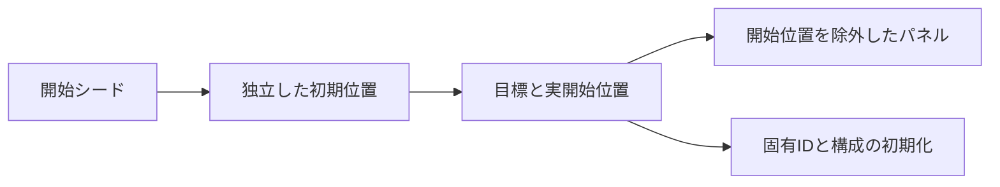

# 設計

## 背景と制約

- 提案: [proposal.md](proposal.md)
- 前提: openspec/tech.md の 技術上の判断基準、表示原則、テスト方針

## 設計判断

### D-01 - 選択枠を初期フォーカスへ渡す

- 選択: BUILDのモーダルは編集中のSLOTを初期フォーカスとして指定し、フォーカス循環の共通処理で尊重する。
- 理由: 毎回先頭へ戻るために生じた二重の下線を除き、編集先とフォーカスを一致させる。
- 代替案: 全画面のフォーカスを無効にする案はキーボード操作を失うため採用しない。
- 昇格: なし

### D-02 - 種類に応じた表示だけを変える

- 選択: CLASSは候補構成の実CORE順から5色の四角を描く。SKILLはリング描画へ入らず、効果と対象位置を上へ集める。共通案内はCLASS、SKILLとOPERATIONだけで省く。候補更新時は確定と取消も再描画する。
- 理由: 装備と変異の選択表示を維持し、不要な説明だけを取り除ける。
- 代替案: 候補データの説明を一律削除するとARMSとGEARにも影響するため採用しない。
- 昇格: なし

### D-03 - 開始時だけ独立した配置を生成する

- 選択: 独立したspawn_layoutがシードとステージから6枠を生成し、battleが実配置を確定してから既存のパネル生成へ渡す。
- 理由: パネルは実開始位置を除外し、配置の乱数消費が他の処理へ漏れない。
- 代替案: 生存者を後からずらす方法はパネルと初期状態が食い違うため採用しない。
- 昇格: openspec/tech.md の 技術上の判断基準

通常は左側の2列3行から3枠を選び、敵を鏡映する。\
REACHとOCCUPYではAを従来の目標に固定し、残る敵2体をその近くから選ぶ。\
隣接の空きを失う組合せは候補に含めない。\
OPERATIONの小図は固定の出発点の代わりに開始可能領域を示す。

調整値はgame/tuning.gdへ集約する。\
陣営の範囲は2列3行、左側の列始点は1から2、行始点は2から5、陣営間の最小マンハッタン距離は3とする。\
CORE見出しはy=220へ12下げ、下の余白を上へ移す。\
削除した再配分の補助文の跡は、左のプレビューをy=428へ28上げて詰める。\
CLASSの四角は行内y=19の14角で22間隔、指示を省く選択画面の上端は88とし、既存のリングと装備画面の寸法は変えない。\
ASSEMBLYは上と下の各40を詰め、中央を保って高さ464、操作y=388へ収める。

## 検証計画

| シナリオID | 設計判断 | 検証方法 |
| --- | --- | --- |
| REQ-014-S01 | なし | 自動テスト |
| REQ-014-S02 | D-01、D-02 | 自動テスト |
| REQ-042-S01 | D-02 | 自動テスト |
| REQ-042-S02 | D-02 | 自動テスト |
| REQ-042-S03 | D-02 | 自動テスト |
| REQ-042-S04 | D-02 | 自動テスト |
| REQ-042-S05 | D-01 | 自動テスト |
| REQ-042-S06 | D-02 | 自動テスト |
| REQ-060-S01 | D-03 | 自動テスト |
| REQ-060-S02 | D-03 | 自動テスト |
| REQ-060-S03 | D-03 | 自動テスト |

構成検証と候補の境界は既存の部品テストを保ち、表示と入力は画面の接続で確認する。\
配置の不変条件は開始モデルで検証し、通常開始の異なるシードは画面で接続だけを確認する。\
固定配置で位相と行動を検証する既存のテストは、明示的な固定配置のfixtureを使い、期待値を維持する。\
日英と標準、最小の実描画は補助検証とする。\
新しい非機能要件と保存形式の移行はない。

## リスクと移行

初期位置が変わるため、以前の固定座標の再生は専用fixtureと区別する。\
パネルの計算へ実位置を渡し、移動前から勝敗が成立しないことを確認する。\
実保存と設定、変更不要のピッカーはハッシュと実描画の比較で保護する。
