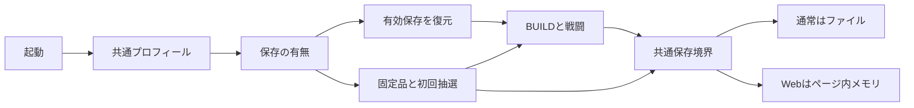

# 設計

## 背景と制約

- 提案: [proposal.md](proposal.md)
- 前提: openspec/tech.mdの技術上の判断基準とテスト方針。

## 設計判断

### D-01 - 起動入口と抽選

- 選択: アプリの起動入口からプロフィールを開き、既存ファイルがない場合だけ固定初期collectionへ追加抽選する。5軸それぞれが単独最大となる未所持カタログ群から1種ずつ選び、候補不足なら残りから補う。抽選乱数は戦利品と初期盤面から独立させ、数値を変更しない。
- 理由: 全126配分を使いながら、全て似た配分になる偏りを避ける。保存の存在を初回判定に使えば既存保存への追加マーカーと移行が不要になる。
- 代替案: 一様抽選だけでは配分が偏り、保存ごとに再抽選する方法は既存解放を変えるため採用しない。
- 昇格: openspec/tech.mdの技術上の判断基準。

### D-02 - 共通の保存境界

- 選択: 保存境界を共通部品へ集約し、通常は既存パスの原子的ファイル保存と退避、Webは静的なメモリ辞書とする。起動中のcollection参照もセッションで保持し、シーンの再作成で失わない。既存の手動SAVEを残し、通常版では初回作成以外の自動上書きを行わない。
- 理由: Web専用の収集や戦闘、設定の分岐を避け、全設定が同じ保存先選択に従う。起動時の破損保存は読込エラーを表示して上書きしない。書込失敗でもセッションの抽選結果を保持する。
- 代替案: user://の既定Web保存は永続化するため採用しない。localStorageとIndexedDBも使用しない。
- 昇格: openspec/tech.mdの技術上の判断基準、openspec/structure.mdの配置原則。

### D-03 - 初回解放の通知

- 選択: 初回抽選結果をセッション内の未表示リストとして保持し、アプリの最初のBUILD表示で一度だけ取り出す。RESULTの黒い面と見出し、型番と5値の階層を使い、ARMSとGEARを左右へ5件ずつ並べる。RESULT自体へ変更を加えない。
- 理由: 固定初期品と報酬を混ぜず、明示保存と通知状態を独立させる。通知を保存形式へ追加しないため、既存保存で再通知しない。
- 代替案: BUILD再訪ごとの表示は採用しない。
- 昇格: なし。

### D-04 - Web起動の永続化禁止

- 選択: 単一スレッドのWeb用プリセットとHTMLシェルを置き、Engine初期化前にpersistentPathsを空、serviceWorkerを空に固定しPWAを無効にする。
- 理由: ゲームがファイルへ書かないだけでなく、Godot既定の永続マウントも避ける。
- 代替案: 既定HTMLシェルへ任せる方法は採用しない。実エクスポート用テンプレートが未導入のため実ブラウザ確認は限界として報告する。
- 昇格: openspec/structure.mdの配置原則。

## 検証計画

| シナリオID | 設計判断 | 検証方法 |
| --- | --- | --- |
| REQ-061-S01 | D-01 | 自動テスト |
| REQ-061-S02 | D-01、D-02 | 自動テスト |
| REQ-061-S03 | D-01、D-02 | 自動テスト |
| REQ-061-S04 | D-03 | 自動テスト |
| REQ-062-S01 | D-02 | 自動テスト |
| REQ-062-S02 | D-02、D-04 | 自動テスト |
| REQ-062-S03 | D-01 | 実機確認 |

抽選は部品、保存と起動は処理の流れで検査し、UIでは接続だけを代表例で確かめる。\
WebシェルはEngineを代替したNode実行で起動時設定を検査し、実WebGL動作とは区別する。

## リスクと移行

有効な既存セーブは形式とバイト列を保ち、初回抽選を再適用しない。\
実際の保存と設定へ検証を向けず、隔離パスとメモリモードを使う。\
実Webエクスポートとブラウザの再読み込みは環境が整った後の確認として残す。
