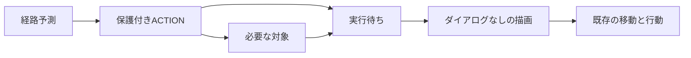

# 設計

## 背景と制約

- 提案: [proposal.md](proposal.md)
- 前提: openspec/tech.md の 技術上の判断基準と表示原則

## 設計判断

### D-01 - ACTIONの入力を短く保護する

- 選択: ACTIONを開いた時に各ボタンの本来の可否を保持して無効にし、game/tuning.gdの保護時間0.12秒を経て、マウスと確定キーが離された後に復元する。開いた時に背後のHUDフォーカスを解除する。
- 理由: 前のクリックや押しっぱなしを新しい操作として再生せず、通常の判断のテンポを妨げない。
- 代替案: 押下を予約して後から実行する方法は誤った選択を持ち越すため採用しない。
- 昇格: なし

### D-02 - 消去を描画してから予定を一度実行する

- 選択: 既存のREADYは内部の予定だけに残し、対象または行動選択で実行待ちへ移る。モーダルを隠して破棄し、その描画後の次の処理で原本へ一度だけ移動を確定し、既存の移動と行動へ渡す。
- 理由: 既存の予測と実計算を使いながら、ダイアログに移動の冒頭が隠れることを防げる。
- 代替案: 固定時間だけ遅らせても実描画の完了を保証できず、遅い環境で重なるため採用しない。
- 昇格: openspec/tech.md の 技術上の判断基準

描画を行わないheadless検査では次の処理フレームを表示境界の代わりにする。\
実描画の境界はGodotの描画完了通知で確認する。\
待機中は別の確定と盤面入力を拒否し、補助画面とフォーカス喪失では止め、復帰時も消去した新しい描画を待ち、RESTARTとBUILDで古い実行待ちを破棄する。\
攻撃前の一拍と移動の長さ、CPUの表示進行は変えない。

## 検証計画

| シナリオID | 設計判断 | 検証方法 |
| --- | --- | --- |
| REQ-046-S01 | D-02 | 自動テスト |
| REQ-046-S02 | D-02 | 自動テスト |
| REQ-046-S03 | D-02 | 自動テスト |
| REQ-046-S04 | D-02 | 実機確認 |
| REQ-010-S01 | D-02 | 自動テスト |
| REQ-010-S02 | D-02 | 自動テスト |
| REQ-010-S03 | D-02 | 自動テスト |
| REQ-010-S04 | D-02 | 自動テスト |
| REQ-010-S05 | D-01、D-02 | 自動テスト |
| REQ-012-S01 | D-02 | 自動テスト |
| REQ-012-S02 | D-02 | 自動テスト |
| REQ-012-S03 | D-02 | 自動テスト |
| REQ-012-S04 | D-02 | 自動テスト |

予定の合法性は既存のモデル、表示の確定境界と入力は画面の接続で確認する。\
同じ判断を複数の層で網羅せず、実描画は補助確認として行う。\
既存台帳の未確認を維持し、新しいバランスと保存形式、非機能要件はない。

## リスクと移行

古い撮影とテストのCONFIRM押下は新しい対象選択による確定と区別する。\
終了手数と勝敗の期待値を追加せず、旧実行待ちと押下の持越しを境界で確かめる。\
通常セーブと設定の移行はない。
